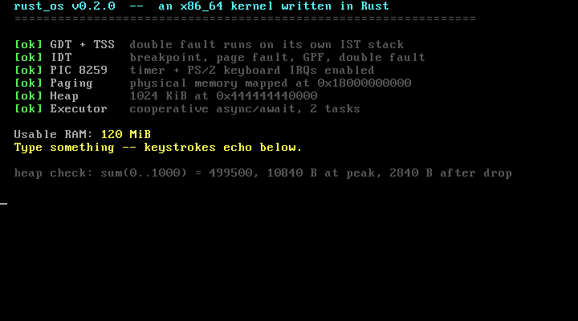
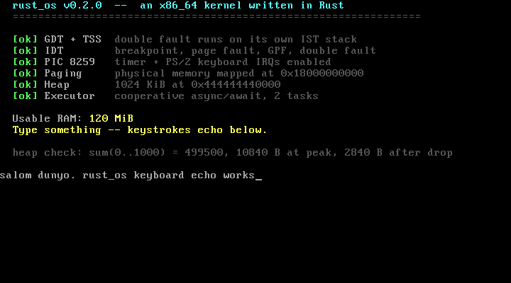

# rust_os

A small x86_64 kernel written in Rust. It boots on bare metal, handles CPU
exceptions and hardware interrupts, manages its own virtual memory and heap, and
runs `async`/`await` tasks on a cooperative scheduler — in about 1,000 lines of
code.



## What it does

| Subsystem | Implementation |
| --- | --- |
| **Boot** | BIOS boot via `bootloader`, long mode entered before `kernel_main` |
| **VGA** | 80x25 text driver, volatile MMIO, colours, scrolling, hardware cursor |
| **Serial** | COM1 UART — how the kernel talks to the host and reports test results |
| **GDT + TSS** | Double-fault handler on a dedicated IST stack, so a stack overflow panics instead of rebooting |
| **IDT** | Breakpoint, page fault, general protection fault, double fault |
| **Interrupts** | 8259 PICs remapped above the exception vectors; timer + PS/2 keyboard |
| **Paging** | `OffsetPageTable` over the bootloader's physical memory map |
| **Heap** | 1 MiB mapped at boot, backed by a linked-list allocator — `Box` and `Vec` work |
| **Tasks** | Wake-driven `async` executor that `hlt`s when idle instead of spinning |

Keystrokes travel from the IRQ handler through a lock-free queue into an async
task, which decodes scancodes and echoes them:



## Running it

Requires **Rust nightly** (unstable ABI and test features), QEMU, and
[`bootimage`](https://github.com/rust-osdev/bootimage).

```sh
cargo install bootimage
brew install qemu           # or: apt install qemu-system-x86

cargo run                   # boot the kernel in QEMU
cargo test                  # 15 tests, each booting a real kernel image
```

`rust-toolchain.toml` pins the channel and pulls in `rust-src`, `llvm-tools` and
the `x86_64-unknown-none` target automatically.

## Testing

There is no `std`, so there is no test harness — the kernel provides its own.
Each test binary is a complete kernel that boots in QEMU, reports over the serial
port, and shuts the machine down through the `isa-debug-exit` device. The exit
code becomes the test result.

That means failures are real: `stack_overflow` genuinely exhausts the stack and
passes only because the IST stack catches the double fault, and `should_panic`
genuinely panics.

## Layout

```text
src/
  main.rs        entry point, boot banner, task spawning
  lib.rs         init sequence and the custom test harness
  vga_buffer.rs  VGA text-mode driver
  serial.rs      COM1 UART driver
  gdt.rs         GDT, TSS, and the double-fault stack
  interrupts.rs  IDT, exception handlers, PIC wiring
  memory.rs      page tables and the frame allocator
  allocator.rs   kernel heap
  task/          async executor and the keyboard task
tests/           integration tests, one bootable kernel each
```

## Notes

- The kernel is linked non-PIE at `0x200000`; `x86_64-unknown-none` defaults to a
  position-independent image at address 0, which `bootloader` cannot load.
- `scripts/qemu-runner.sh` works around a stale assumption in `bootimage` about
  where Cargo puts test binaries. Without it, tests hang until they time out.
- `bootloader` is pinned to the 0.9 line, which still provides VGA text mode.
  0.11 replaces it with a raw framebuffer and needs a font renderer instead.

## Credits

Built following [Writing an OS in Rust](https://os.phil-opp.com/) by Philipp
Oppermann, then updated to current crate APIs and the 2024 edition.

[MIT](LICENSE)
